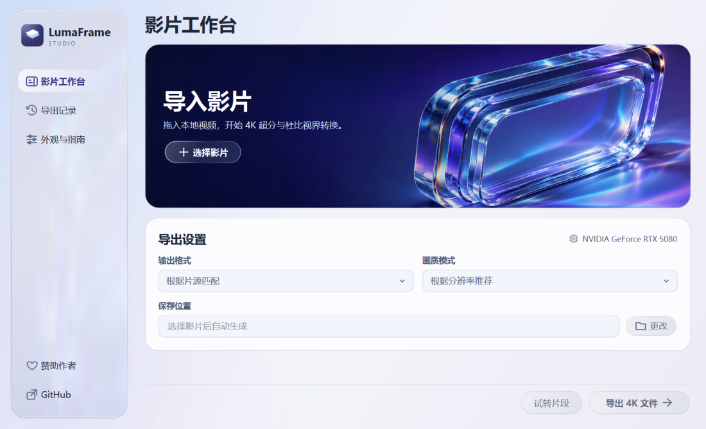

# LumaFrame Studio

在 Windows 上把本地电影制作成 4K MKV。原生 4K 双层杜比碟源可以原样保留 Profile 7，也可以把基础层和 FEL 增强层合成为兼容 HDR10 的 Profile 8.1。支持 NVIDIA GPU 超分、单层杜比转换，以及普通 BT.709 视频转 HDR10 或杜比视界。

[从官网下载](https://www.lingjie.cyou/projects/lumaframe-studio/) · [GitHub Releases](https://github.com/lingjieheti/LumaFrame-Studio/releases/latest) · [超分实测](docs/quality.md) · [双层画质验证](docs/profile7.md) · [赞助作者](https://github.com/lingjieheti/suzerain-save-studio/blob/main/SPONSOR.md)



## 使用

1. 安装后打开 **LumaFrame Studio**，将影片拖入预览区。安装程序会校验并复用系统里匹配的 FFmpeg 8.1，或从上游下载它。离线安装可将[原版 FFmpeg 压缩包](https://github.com/GyanD/codexffmpeg/releases/download/8.1/ffmpeg-8.1-full_build.7z)放在安装程序旁，无需手动解压。
2. 原生 4K Profile 7 默认选择 **原样保留双层**，完整保留基础层、增强层和原动态元数据。若播放器需要单层，选择 **杜比视界 Profile 7 → Profile 8.1**。低于 4K 的双层片源可合成后超分。普通 BT.709 视频可选择 **生成 HDR10** 或 **生成杜比视界**。
3. 默认 **NVIDIA RTX AI · 高码率 Ultra**，使用 NVIDIA 官方十位超分模型和高码率硬件编码，优先考虑画质。第一次使用会从 NVIDIA 下载约 416 MiB 的运行库，校验后在本机缓存。也可以选择内置 **FSRCNNX**，在 NVIDIA GPU 上增强亮度细节，配合 x265 慢速 CRF 14 编码。两种模式在不同镜头上的表现与文件大小可查阅上面的画质实测。
4. **试转片段** 会在选定目录保存影片中段关键帧附近约 5 秒的无声 4K 试片。可以分别试转两种算法，在实际观看的电视上比较颗粒、轮廓、天空和运动画面。满意后点 **导出 4K 文件**。
5. 软件对成片重新读取，核对尺寸、色彩标记、帧数和显示时间。杜比输出还会重新抽取动态元数据，与预期的 RPU 数据逐帧对应并校验摘要。只有校验通过才写入最终文件名。

## 支持的输入和输出

| 片源 | 成片 | 处理方式 |
|---|---|---|
| 原生 4K 双层 HEVC Profile 7 | 双层 Profile 7 MKV | 原样保存压缩画面，核对两层编码数据、RPU 与帧时间 |
| Profile 7 FEL | 单层 Profile 8.1 | 根据原始逐帧 RPU 合成基础层与增强残差，在 12 位 PQ 工作空间处理，输出 10 位 HEVC |
| Profile 7 MEL | 单层 Profile 8.1 | 使用 HDR10 基础层，转换原有动态元数据，按目标分辨率适配有效画面 |
| 单层 HEVC Dolby Vision Profile 8.1 | Dolby Vision Profile 8.1 | 保留原动态元数据，按输出尺寸调整逐镜有效画面区域 |
| 单层 HEVC Dolby Vision Profile 5 | Dolby Vision Profile 8.1 | 先重建 Profile 5 画面，再生成 HDR10 兼容基础层并转换原杜比元数据 |
| 普通 BT.709 SDR | HDR10 | 重建 BT.2020/PQ 画面，自动扩展高光，目标峰值 1000 尼特 |
| 普通 BT.709 SDR | Dolby Vision Profile 8.1 | 先制作 HDR 画面，再估算各镜头亮度并生成新的动态元数据 |

双层输入支持单轨交织的 HEVC 视频，以及明确标注基础轨与增强轨依赖关系的双视频轨 MP4。完整 FEL 合成需要支持 AVX2 的 x64 处理器；双层原样保留可以直接复制。混合 MEL/FEL 的原生 4K 片源可使用原样保留模式。双层播放器、电视与容器支持影响最终播放效果。[双层验证与适用范围](docs/profile7.md)

自动制作的杜比视界反映软件对 SDR 素材的映射。电影中已剪掉的高光或已丢失的细节无法从原片确认。Profile 8.4、隔行视频和需要旋转矩阵的片源会提示不支持。部分无色彩标记的高清视频按照 BT.709 解释，并在界面提示。常规超分按原画幅适配 3840 × 2160。宽银幕电影可以输出例如 3840 × 1600；已经是 3840 至 4096 像素宽的合规 4K 片源可以保持原尺寸。

整片导出会复制兼容的原音轨、字幕、章节和附件。请在目标磁盘预留足够的临时空间，长片处理中会同时存在视频裸流和已封装的成片。程序拒绝覆盖同名文件。项目已在 RTX 5080 上测试，实际编码用时与片源复杂度、CPU、GPU 和显存有关。HDR / 杜比映射的最终观感需在相应设备上确认。

## 界面

导航和预览按钮使用随背景变化的玻璃材质。可在 **外观与指南** 切换浅色、深色，调整玻璃浓度，或启用减少透明度。Windows 本地绘制界面，视频在本机处理。


## 从源码运行或打包

Windows x64，Python 3.12，7-Zip。NVIDIA GPU 路径需要支持相应 Vulkan / CUDA / NVENC 功能的驱动。体积较大的媒体工具通过固定版本和 SHA-256 获取。

```powershell
py -3.12 -m venv .venv
.\.venv\Scripts\python.exe -m pip install -r requirements-build.txt
.\.venv\Scripts\python.exe tools/fetch_tools.py
.\.venv\Scripts\python.exe tools/fetch_fel.py
.\.venv\Scripts\python.exe main.py
```

Windows 安装包使用 Inno Setup 6。可先运行桌面冒烟检查，再打包。

```powershell
.\.venv\Scripts\python.exe tests/test_desktop.py
.\tools\build.ps1 -Python (Resolve-Path .\.venv\Scripts\python.exe).Path -InnoCompiler "C:\Program Files (x86)\Inno Setup 6\ISCC.exe"
```

命令行可通过同一处理引擎运行。输出文件和 JSON 结果文件需使用新文件名。

```powershell
.\LumaFrameStudio.exe --export movie.mkv --target preserve --mode neural --output movie-4K.mkv --result result.json
```

目标值为 `keep7`（原生 4K 双层原样保留）、`preserve`（保留或转换到 Profile 8.1）、`hdr10`、`newdv`。模式值为 `neural`、`rtx`、`reference` 和适用于 Profile 8.1 的 `quality`。附加 `--sample` 可试转片段。省略目标时，符合原生双层条件的片源优先保留 Profile 7。

[引擎与设计取舍](docs/engineering.md) · [第三方许可与源码](THIRD_PARTY.md)
