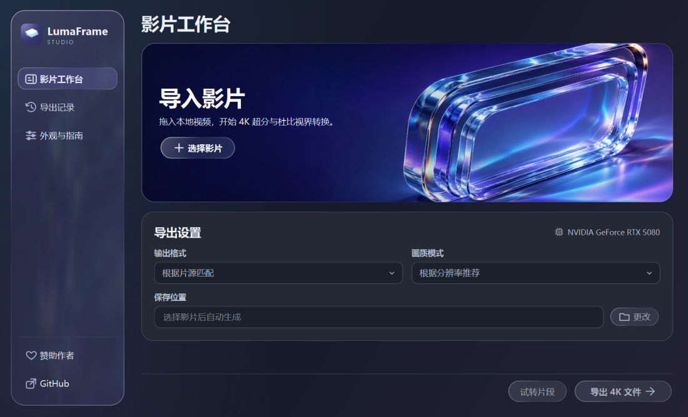

# LumaFrame Studio

在 Windows 上把本地电影制作成 4K MKV。原生 4K 双层杜比碟源可以原样保留 Profile 7，也可以把基础层和 FEL 增强层合成为兼容 HDR10 的 Profile 8.1。支持 NVIDIA GPU 超分、单层杜比转换，以及普通 BT.709 视频转 HDR10 或杜比视界。

[从官网下载](https://www.lingjie.cyou/projects/lumaframe-studio/) · [GitHub Releases](https://github.com/lingjieheti/LumaFrame-Studio/releases/latest) · [超分实测](docs/quality.md) · [双层画质验证](docs/profile7.md) · [赞助作者](https://github.com/lingjieheti/suzerain-save-studio/blob/main/SPONSOR.md)

**1.8.1 全自动导出** 将影片拖入工作台，点「导出 4K 文件」即可。软件读取片源格式和尺寸，自动确定输出格式、超分方法和调色方式。「自动处理」显示本次采用的方案。保存位置默认为片源目录，输出格式与保存位置可按播放设备和存储需要更改。

BT.709 SDR 自动逐镜调色。一般镜头保留原有明暗关系并调整高光；持续欠曝且阴影仍有纹理时才使用内置模型。每个镜头固定调色参数，含有效超白细节的镜头会保留白色以上的层次。模型不可用时自动采用自适应高光。

**1.5.2 矮窗口布局** 在笔记本和较高 Windows 缩放比例下，工作台会依据实际可用高度收紧顶部影片预览。输出格式选择框保持完整可见，导出时仍可直接看到进度和剩余时间。

**H.264 试片** 在带 B 帧的开放 GOP 素材中，截取中段可能会带入依赖前一组画面的帧，导致旧版报时间戳错误。新版按可解码的帧边界截取约 5 秒的试片，再进行超分和成片校验。

**1.5.0 多语言界面** 在「外观与指南 → 界面语言」中可选简体中文、English、日本語或跟随系统，导出期间也能切换。新安装默认跟随系统，已有偏好的旧版用户升级后沿用中文。命令行可用 `--language en` 或 `--language ja` 选择进度和错误提示的语言，JSON 字段名和状态值保持兼容。

本版修复蓝光 PGS 字幕重新封装后可能被误判为时间偏移的问题。新打开的影片默认输出到片源目录，可为单部影片手动更改保存位置。

**1.5.1 玻璃导出栏** 试转或整片导出时，工作台底部以大号数字并列显示总进度和整片预计剩余时间，旁边列出本阶段剩余时间和实时速度。下方显示正在执行的步骤、已处理帧数或数据量、已用时间，以及取消按钮。刚开始和切换阶段时会先显示「估算中」，取得足够的实测速率后再显示时间。成片通过校验后显示 100%。操作栏随深浅主题、玻璃浓度和减少透明度偏好调整。

**RTX 速度** 桌面自动导出使用标准缓冲。命令行可通过 `--speed fast` 启用额外缓冲，使超分和编码并行。两档使用相同的 RTX 模型、强度与编码参数。[速度与画质实测](docs/speed-1.4.2.md)

低于目标尺寸的静态 HDR10 可直接超分至 4K HDR10 或杜比视界。新编码的 HDR10 和杜比文件按最终画面实测 MaxCLL/MaxFALL，支持指定电影黑边。[片源和实测](docs/quality-1.4.1.md) · [跨方案与运动压力测试](docs/coverage-1.4.1.md) · [压缩片源修复](docs/compressed-1.4.md) · [新制杜比的剪辑识别](docs/scene-analysis-1.4.1.md)


## 使用

1. 安装后打开 **LumaFrame Studio**，将影片拖入预览区。安装程序会校验并优先复用上一次安装或系统里匹配的 FFmpeg 8.1，或从上游下载它。离线安装可将[原版 FFmpeg 压缩包](https://github.com/GyanD/codexffmpeg/releases/download/8.1/ffmpeg-8.1-full_build.7z)放在安装程序旁，无需手动解压。
2. 直接点 **导出 4K 文件**。符合条件的原生 4K 双层杜比保留 Profile 7，保留基础层、增强层和原动态元数据。SDR 与静态 HDR10 优先生成单层杜比视界 Profile 8.1。
3. 需要放大时，兼容的 RTX 显卡优先使用十位 NVIDIA 超分和高码率编码。第一次使用 RTX 超分会从 NVIDIA 下载约 416 MiB 的运行库，校验后在本机缓存。已达目标尺寸的影片按格式保留原有编码或进行必要的转换。
4. 如要先看效果，点 **试转片段**。软件使用相同的自动处理方案，在选定目录保存影片中段关键帧附近约 5 秒的无声 4K 试片。
5. 软件对成片重新读取，核对尺寸、色彩标记、帧数和显示时间。杜比输出还会重新抽取动态元数据，与预期的 RPU 数据逐帧对应并校验摘要。只有校验通过才写入最终文件名。

原生 4K Profile 8.1 输入默认使用 **无损封装**，已有 MKV 可逐字节保留。原生 4K Profile 7 MEL 转单层时，参考模式会保留原编码基础层并转换逐帧元数据。SDR 输出自动按镜头选择映射。需要具体控制算法、亮度映射或分析边距的批量作业，可使用命令行参数。

## 支持的输入和输出

| 片源 | 成片 | 处理方式 |
|---|---|---|
| 原生 4K 双层 HEVC Profile 7 | 双层 Profile 7 MKV | 原样保存压缩画面，核对两层编码数据、RPU 与帧时间 |
| Profile 7 FEL | 单层 Profile 8.1 | 根据原始逐帧 RPU 合成基础层与增强残差，在 12 位 PQ 工作空间处理，输出 10 位 HEVC |
| Profile 7 MEL | 单层 Profile 8.1 | 使用 HDR10 基础层，转换原有动态元数据，按目标分辨率适配有效画面 |
| 单层 HEVC Dolby Vision Profile 8.1 | Dolby Vision Profile 8.1 | 保留原动态元数据，按输出尺寸调整逐镜有效画面区域 |
| 单层 HEVC Dolby Vision Profile 5 | Dolby Vision Profile 8.1 | 先重建 Profile 5 画面，再生成 HDR10 兼容基础层并转换原杜比元数据 |
| 已达目标画幅的静态 HDR10 HEVC Main 10 | Dolby Vision Profile 8.1 | 保留原始编码画面，沿用 ST 2086 母版亮度，逐镜生成新元数据 |
| 需要放大的静态 HDR10 HEVC Main 10 | 4K HDR10 或 Dolby Vision Profile 8.1 | 直接超分 BT.2020/PQ，支持高码率 RTX、压缩修复、FSRCNNX、Spline36 |
| 普通 BT.709 SDR | HDR10 | 按所选亮度映射生成 BT.2020/PQ 画面 |
| 普通 BT.709 SDR | Dolby Vision Profile 8.1 | 先制作 HDR 画面，再估算各镜头亮度并生成新的动态元数据 |

双层输入支持单轨交织的 HEVC 视频，以及明确标注基础轨与增强轨依赖关系的双视频轨 MP4。RTX、FSRCNNX 和参考模式均可直接接收合成后的 12 位画面，省去整片的无损临时视频。完整 FEL 合成需要支持 AVX2 的 x64 处理器；双层原样保留可以直接复制。混合 MEL/FEL 的原生 4K 片源可使用原样保留模式。双层播放器、电视与容器支持影响最终播放效果。[双层验证与适用范围](docs/profile7.md)

新制作 HDR10 或杜比时，工作台默认分析完整画面。命令行使用 `--target newdv --active-area 0 0 276 276` 可排除上下各 276 个输出像素参与分析，保留完整编码画面。自动元数据描述新输出，原片中已剪掉的高光或已丢失的细节无法从原片确认。Profile 8.4、隔行视频和需要旋转矩阵的片源会提示不支持。部分无色彩标记的高清视频按照 BT.709 解释，并在界面提示。常规超分按原画幅适配 3840 × 2160。宽银幕电影可输出例如 3840 × 1600，已达目标尺寸的合规 4K 原片可按所选路径保留原尺寸。

整片导出会复制兼容的原音轨、字幕、章节和附件。请在目标磁盘预留足够的临时空间，长片处理中会同时存在视频裸流和已封装的成片。界面遇到同名文件会自动编号，试转后会保留为整片选择的文件名。命令行遇到同名文件会停止。项目已在 RTX 5080 上测试，实际编码用时与片源复杂度、CPU、GPU 和显存有关。HDR / 杜比映射的最终观感需在相应设备上确认。

## 界面

1.2.0 的浮动侧栏从当前封面或影片缩略图取色，预览上的选择按钮会折射下方画面。窄窗口会收起导航文字，试转与导出按钮固定在工作台底部。按 **Ctrl+O** 打开影片，或用 **Tab** 在控件之间移动。

打开 **外观与指南** 可切换浅色与深色，拖动浓度滑块，在同一组色带上比较清透和磨砂效果。启用 **减少透明度** 后，控件使用实色。软件也会读取 Windows 的透明效果和动画偏好。



## 从源码运行或打包

Windows x64，Python 3.12，7-Zip。NVIDIA GPU 路径需要支持相应 Vulkan / CUDA / NVENC 功能的驱动。体积较大的媒体工具通过固定版本和 SHA-256 获取。

```powershell
py -3.12 -m venv .venv
.\.venv\Scripts\python.exe -m pip install -r requirements-build.txt
.\.venv\Scripts\python.exe tools/fetch_tools.py
.\.venv\Scripts\python.exe tools/fetch_fel.py
.\.venv\Scripts\python.exe main.py
```

Windows 安装包使用 Inno Setup 6。可先运行桌面冒烟检查，再打包。

```powershell
.\.venv\Scripts\python.exe tests/test_desktop.py
.\tools\build.ps1 -Python (Resolve-Path .\.venv\Scripts\python.exe).Path -InnoCompiler "C:\Program Files (x86)\Inno Setup 6\ISCC.exe"
```

命令行可通过同一处理引擎运行。需要跟踪批量任务时，可选用 `--progress-file live.json`，读取其中的进度、速度和预计剩余秒数。剩余时间处于估算中时为 `null`。输出文件、进度和验收结果分别使用新文件名。

```powershell
.\LumaFrameStudio.exe --export movie.mkv --target preserve --mode neural --output movie-4K.mkv --result result.json
```

目标值为 `keep7`（原生 4K 双层原样保留）、`preserve`（保留或转换到 Profile 8.1）、`hdr10`、`newdv`。模式值为 `neural`、`rtx`、`reference`、适用于 Profile 8.1 的 `quality` 和手选的压缩片源修复 `rtx_compressed`。`copy` 可无损封装尺寸匹配的 Profile 8.1，也可在原生静态 HDR10 选择 `newdv` 时沿用原编码画面。附加 `--sample` 可试转片段。省略目标和模式时，软件根据片源匹配处理方案。符合原生双层条件的片源优先保留 Profile 7。SDR 输入默认使用 `--sdr-mapping auto` 自动逐镜调色。`reference` 选择 203 尼特参考白，`expand` 固定扩展高光。旧脚本显式使用的 `scene`、`cinema` 映射继续沿用原行为。验收 JSON 中的 `auto_adaptive_shots`、`auto_model_shots` 分别是两种算法实际处理的镜头数。`auto_model_unavailable_shots` 是模型不可用而使用自适应高光的镜头数，已计入 `auto_adaptive_shots`。

[引擎与设计取舍](docs/engineering.md) · [第三方许可与源码](THIRD_PARTY.md)
