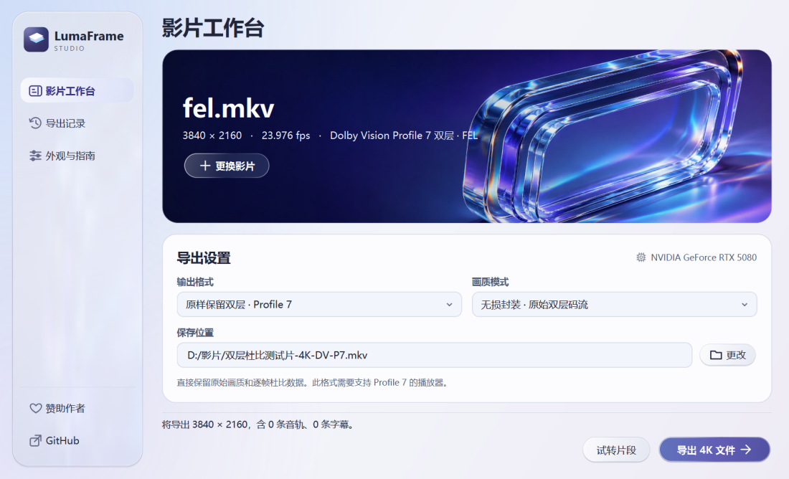

# Profile 7 双层杜比的画质与验证

LumaFrame Studio 1.1.0 可把原生 4K Profile 7 保存为双层 MKV，也可将双层片源制作成单层 Profile 8.1。若播放器能播放原片的双层格式，选 **原样保留双层** 可避免重新编码。对需要单层的播放器，FEL 转换会逐帧合成基础层、增强层的残差和原 RPU；最后输出 HDR10 兼容的 10 位 HEVC。低于 4K 时可接 NVIDIA RTX AI、FSRCNNX 或 Spline36。



## 原样保存与容器兼容

测试使用 FelBaker 的 150 帧公开测试向量。基础层为 3840 × 2160、增强层为 1920 × 1080。在单轨交织 MKV、单轨交织 MP4 和具有 `tref/vdep` 引用的双轨 MP4 上分别执行原样保留，并复读成片核对编码图像、显示时间和动态元数据。三种布局的基础层、增强层、RPU 摘要一致，交织 MKV 的整文件 SHA-256 与输入完全相同。三种布局也通过了 121 帧试片导出。缺少真实增强层的测试文件和缺少依赖关系的双轨 MP4 均被拦截。[上游测试流](https://github.com/bbeny123/felbaker/tree/1.0.0/test/samples) · [FFmpeg 对 MP4 轨道依赖的解析](https://github.com/FFmpeg/FFmpeg/blob/master/libavformat/mov.c)

| 原生 4K FEL 完整保存，150 帧 | SHA-256 |
|---|---|
| 交织 MKV 整文件 | `85f5635ae831b09fe2c34c99056ff9667264e2255482b0d76cf87d7fc3bcd899` |
| 基础层编码数据签名 | `81b8fd637cc075adfae41fe3bc3162903679b8a316e124814190b45c34c4fab5` |
| 增强层编码数据签名 | `7493cf0a25cf6a2004fcd87dd76841d28314e16cf82c3f98f70144a34a0ef9b7` |
| 原始 RPU | `8e0156973ead846f5423082b9d107fd9780f81b43ccbcf6b732ae1d09e36cd80` |

## 增强层是否真正进入了画面

**上游参考复现。** 读取两层和原始逐帧 RPU，在 VapourSynth 中以 FelBaker 1.0.0 重建高位深 RGB。按上游的平面排列计算前 50 帧和前 100 帧的 SHA-256。两个摘要均与上游发布的参考值逐字节相同。另将增强层改成恒定中灰并保持基础层和 RPU 相同，在第 0、24、49、74、99、124、149 帧测得 57.26% 至 62.00% 的亮度样点变化，峰值差为 80 至 91 个 12 位码值。[参考值](https://github.com/bbeny123/felbaker/blob/1.0.0/test/tests.toml) · [下载及复测脚本](../tools/bench/verify_fel.py)

**最终 4K 文件的受控实验。** 制作两份 8 帧 1080p 文件，使用同一基础层和同一 FEL RPU，只将第二份增强层中央矩形的亮度从 512 调至 760。分别用两种模式导出 3840 × 2160 Profile 8.1，复读解码第 4 帧的亮度，在矩形内部取 5,130 个样点，外侧取 19,764 个样点。下表是两份文件之间的平均绝对亮度差，以 10 位码值计。测量覆盖了合成、缩放、最终有损编码与解码。[生成受控片源](../tests/profile7_vectors.py) · [测量脚本](../tests/profile7_difference.py)

| 对照路径 | 中央区域 | 外部区域 |
|---|---:|---:|
| 输入只解码基础层，1080p | 0.00 | 0.00 |
| 12 位合成 → Spline36、慢速 x265 CRF 14，4K | 25.00 | 0.30 |
| 12 位合成 → RTX 5080 AI Ultra、NVENC，4K | 24.65 | 0.19 |

**HDR10 回退亮度。** 上述 150 帧实拍样片的基础层标注母版峰值 1000 尼特、MaxCLL/MaxFALL 为 1000/588。合成画面使用一致且有效的原 RPU L6，导出的 HDR10 回退层标注母版峰值 4000 尼特、MaxCLL/MaxFALL 为 9975/978。原样保存双层时保留源信令。试验还覆盖 1080p MEL 转 4K 单层，动态元数据通过复读校验。

## 原生 4K MEL 转单层时保留基础层

选择 Profile 8.1 和参考模式后，软件先分类整片 RPU。对于画幅已匹配的原生 4K MEL，程序直接复制原 HDR10 基础层，并按 dovi_tool 的 mode 2 转换 RPU。成片重新抽取 HEVC，对比编码画面、参数集及附带数据的指纹，再逐帧回读 RPU。FEL 含有效残差，仍需合成画面。[dovi_tool 模式](https://github.com/quietvoid/dovi_tool/tree/2.3.4)

受控样片使用 FelBaker 1.0.0 的公开 150 帧实拍 BL 和 EL，调用 dovi_tool 的 mode 1 生成 MEL 测试码流。原 BL、1.2.0 成片与新版成片均独立解码为 3840 × 2160 的 10-bit YUV 4:2:0。逐帧 SHA-256 与原 BL 相同的帧数由 **0/150 提升到 150/150**。这是对保真度的逐样本检查，无法据此判断旧版误差在人眼观看时是否可见。新旧输出的 P8.1 RPU 均与独立转换的期望值一致，摘要为 `3441e196cb950a9b8f142c0e30e482bf2665d45f93ad5991dee97fb78ae0a76a`。用旧版重编码画面替换待封装的视频并保留同一份 RPU，成片校验检出了画面变化并终止导出。[上游测试素材](https://github.com/bbeny123/felbaker/tree/1.0.0/test/samples)

复测时可用安装目录的工具在空目录运行下列 PowerShell 命令。将上述两份上游文件保存为 `BL-150.hevc`、`EL-150.hevc`。

```powershell
$app = Join-Path $env:LOCALAPPDATA 'Programs\LumaFrame Studio'
$dv = Join-Path $app 'bin\dovi_tool.exe'
$ff = Join-Path $app 'bin\ffmpeg.exe'
& $dv mux --bl BL-150.hevc --el EL-150.hevc -o dual.hevc
& $dv -m 1 convert -i dual.hevc -o mel.hevc
& "$app\bin\mkvtoolnix\mkvmerge.exe" -q -o input.mkv --default-duration 0:24000/1001fps mel.hevc
& "$app\LumaFrameStudio.exe" --export input.mkv --target preserve --mode reference --output output.mkv --result result.json | Out-Host
& $dv -m 2 extract-rpu -i input.mkv -o expected.rpu
& $dv extract-rpu -i output.mkv -o received.rpu
Get-FileHash expected.rpu, received.rpu
function PictureHashes($video) {
    & $ff -v error -i $video -map 0:v:0 -pix_fmt yuv420p10le -fps_mode passthrough -f framehash -hash sha256 - |
        Where-Object { $_ -match '^\s*0,' } | ForEach-Object { ($_ -split ',')[-1].Trim() }
}
$sourceFrames = @(PictureHashes 'BL-150.hevc')
$resultFrames = @(PictureHashes 'output.mkv')
if ($sourceFrames.Count -ne 150 -or ($sourceFrames -join ',') -ne ($resultFrames -join ',')) { throw 'Frame mismatch' }
```

## CM v4.0 的母版色度与 HDR10 回退

L9 可逐镜头描述色原色和白点。LumaFrame 将整片一致且可表达为 HEVC 母版信令的色度写入 HDR10 回退层；使用自定义 L9 的坐标从 1/32767 换算到 1/50000。若片中出现不同母版原色，逐帧 RPU 仍保留这些变化。原有码流里的独立 HDR10 信令有自己的来源。[Dolby 元数据说明](https://professionalsupport.dolby.com/s/article/Dolby-Vision-Metadata-Levels) · [dovi_tool 色度单位和预设](https://github.com/quietvoid/dovi_tool/blob/2.3.4/dolby_vision/src/rpu/extension_metadata/primaries.rs)

三段 960 × 540、各两帧的合成 P5 测试流分别使用自定义 L9、DCI-P3 影院白点和两种 L9 的逐帧切换。均从正式导出入口生成 3840 × 2160 P8.1，MaxCLL/MaxFALL 均读回为 900/300。影院白点读回为 (15700, 17550)/50000。混合片源在 1.2.0 会触发 CSV 列数错误，新版保留了变化的 RPU 并成功回读，在这段无独立母版 SEI 的样片中省略单一静态母版。可用以下命令复核字段转换，或查看实际成品的 SEI。

```powershell
python -m unittest discover -s tests -p test_dovi_mastering.py
& "$app\bin\ffprobe.exe" -v error -select_streams v:0 -read_intervals "%+#1" -show_frames -of json output.mkv
```

## 长片工作空间与适用范围

Spline36 和 FSRCNNX 可将 12 位合成结果直接流入编码器。以 150 帧 4K FEL 实拍素材比较，流式参考档与先写无损 FFV1 再编码的实现，150 帧解码图像逐帧一致。1080p 受控输入经参考档和 FSRCNNX 放大到 4K，两档各自的两条路径也分别达到 8/8 帧一致。所有模式仍需目标磁盘空间用于原始轨道、编码和最终封装。

1.1.1 将合成后的 12 位 PQ 帧通过管道直接送入 RTX 路径，保留原分辨率、帧率、有限范围、BT.2020/PQ 和色度位置。1.1.0 的离线测试中，6.26 秒 4K 素材的无损中间文件约为 1 GB。1.1.1 的交织 Profile 7 拆层也直接通过管道，P8.1 成片从 MKV 直接回读 RPU。原生 4K 单轨交织 MKV 额外回读整个文件的 SHA-256，校验通过后才发布目标文件。软件使用随安装包分发的隔离运行库，启动 FEL 组件前校验关键文件及 SHA-256。

以上文件测试于 2026 年 11 月 24 日完成。干预增强层的实验验证了信号路径，不能量化任意电影的主观观感。当前验证覆盖短片、已说明的封装和一台 RTX 5080；整部商业影片、实体杜比电视播放、蓝光盘目录和专业母版认证尚未验证。双层输出用于原生 4K 原样保留。低分辨率影片放大和普通 SDR 自动制作输出单层文件。混合 FEL/MEL 片源仅开放受支持的原生双层原样保留。
